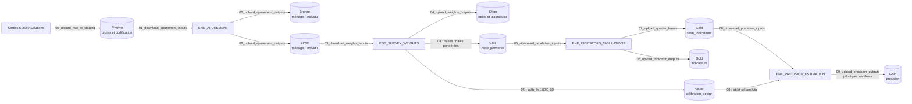
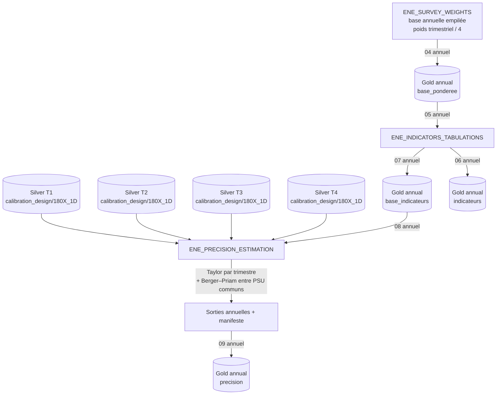
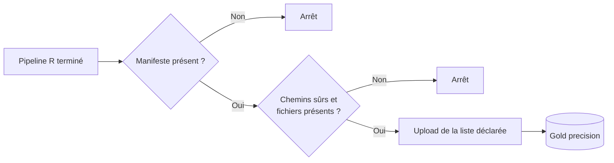

# Schéma d’orchestration de la chaîne ENE et du calcul de précision

**Version documentée : 21 août 2026**

**Dépôt responsable : `ENE_MEDALLION_ORCHESTRATION`**

## 1. Objet

Cette note décrit comment les artefacts ENE circulent entre les dépôts métier
et les couches Staging, Bronze, Silver et Gold de MinIO. Elle détaille surtout
le chemin qui aboutit aux estimations de précision trimestrielles et annuelles.

L’orchestrateur ne calcule ni poids, ni indicateurs, ni variances. Il applique
des **contrats de transport** : source, destination, nom stable, période,
version, format et règles de remplacement. Les traitements statistiques restent
dans les dépôts R et Stata qui en sont propriétaires.

La méthodologie statistique est documentée séparément dans la
[`note mathématique et appliquée de précision`](https://github.com/cae-ins/ENE_PRECISION_ESTIMATION/tree/docs/note-methodologique-precision/docs).

## 2. Principe d’architecture

La chaîne sépare cinq responsabilités.

| Dépôt | Responsabilité métier | Intrants Médaillon | Produits Médaillon |
|---|---|---|---|
| `ENE_APUREMENT` | Ingestion, apurement et standardisation ménage/individu | Staging | Bronze et Silver apurés |
| `ENE_SURVEY_WEIGHTS` | Poids initiaux, ajustements, calibration et bases pondérées | Silver apuré | Silver `poids`, Gold `base_ponderee`, objets `calib_lfs` |
| `ENE_INDICATORS_TABULATIONS` | Construction de la base finale d’indicateurs et tabulations officielles | Gold `base_ponderee` | Gold `base_indicateurs` et `indicateurs` |
| `ENE_PRECISION_ESTIMATION` | Erreurs-types, CV, IC, effets de plan trimestriels et variance annuelle rotative | Gold `base_indicateurs` + Silver `calibration_design` | Gold `precision` |
| `ENE_MEDALLION_ORCHESTRATION` | Transport, nommage, versionnement et contrôles de publication | Tous les préfixes autorisés | Aucun calcul métier |

La règle de propriété Gold est stricte :

```text
base_ponderee     -> ENE_SURVEY_WEIGHTS
base_indicateurs  -> ENE_INDICATORS_TABULATIONS
indicateurs       -> ENE_INDICATORS_TABULATIONS
precision         -> ENE_PRECISION_ESTIMATION
```

Cette séparation répond à un point essentiel de la chaîne : la base utilisée
pour les calculs de précision est la base finale de
`ENE_INDICATORS_TABULATIONS`. Le dépôt de pondération apporte le plan et les
poids calibrés, mais ne produit pas les variables finales d’indicateur.

## 3. Vue d’ensemble trimestrielle



Pour un trimestre `Tq_AAAA`, l’estimation de précision ne démarre que lorsque
deux branches convergent :

1. la base d’indicateurs est publiée dans Gold ;
2. l’image du design calibré officiel est publiée dans Silver sous la stratégie
   demandée, actuellement `180X_1D`.

Les régions ne sont pas un domaine de précision trimestriel. Cette règle est
appliquée dans `ENE_PRECISION_ESTIMATION`, pas dans la couche de transport.

## 4. Vue d’ensemble annuelle



Le flux annuel n’utilise pas un design synthétique qui déclarerait les quatre
trimestres indépendants. Le script `08_download_precision_inputs.py` télécharge
la base annuelle Gold et les quatre objets trimestriels Silver :

```text
gold/enem/annual/{year}/base_indicateurs/
silver/enem/T1_{year}/poids/calibration_design/180X_1D/
silver/enem/T2_{year}/poids/calibration_design/180X_1D/
silver/enem/T3_{year}/poids/calibration_design/180X_1D/
silver/enem/T4_{year}/poids/calibration_design/180X_1D/
```

Le dépôt de précision reconstitue ensuite les points annuels et combine les
variances trimestrielles avec les covariances des PSU communs. Les domaines
régionaux sont activés uniquement à ce stade annuel.

## 5. Espaces de noms MinIO

### 5.1 Période trimestrielle

Pour `T1_2026`, les principaux préfixes sont :

```text
staging/enem/T1_2026/brutes/
staging/enem/T1_2026/codification/

bronze/enem/T1_2026/menage/
bronze/enem/T1_2026/individu/

silver/enem/T1_2026/menage/
silver/enem/T1_2026/individu/
silver/enem/T1_2026/poids/
silver/enem/T1_2026/poids/calibration_design/180X_1D/

gold/enem/T1_2026/base_ponderee/
gold/enem/T1_2026/base_indicateurs/
gold/enem/T1_2026/indicateurs/
gold/enem/T1_2026/precision/
```

### 5.2 Période annuelle

Pour 2025 :

```text
silver/enem/annual/2025/poids/

gold/enem/annual/2025/base_ponderee/
gold/enem/annual/2025/base_indicateurs/
gold/enem/annual/2025/indicateurs/
gold/enem/annual/2025/precision/
```

Le préfixe annuel contient les produits annuels. Les quatre designs nécessaires
à la covariance restent, eux, dans leurs préfixes trimestriels respectifs.

## 6. Catalogue des scripts d’orchestration

| Script | Sens | Dépôt appelant | Contrat principal |
|---|---|---|---|
| `00_upload_raw_to_staging.py` | Local → Staging | Apurement | Charge les données brutes et la vraie codification explicitement sélectionnée |
| `01_download_apurement_inputs.py` | Staging → Local | Apurement | Récupère les sources nécessaires à l’apurement |
| `02_upload_apurement_outputs.py` | Local → Bronze/Silver | Apurement | Publie bases apurées et rapports d’erreurs séparément |
| `03_download_weights_inputs.py` | Silver/Staging → Local | Pondération | Récupère les deux bases apurées stables et les intrants autorisés |
| `04_upload_weights_outputs.py` | Local → Silver/Gold | Pondération | Publie poids techniques, design calibré et bases pondérées finales |
| `05_download_tabulation_inputs.py` | Gold → Local | Indicateurs | Récupère uniquement `base_ponderee` |
| `06_upload_indicator_outputs.py` | Local → Gold | Indicateurs | Publie les tabulations dans `indicateurs` |
| `07_upload_quarter_bases.py` | Local → Gold | Indicateurs | Publie la base de travail finale dans `base_indicateurs`, au trimestre ou à l’année |
| `08_download_precision_inputs.py` | Gold/Silver → Local | Précision | Récupère base d’indicateurs et un ou quatre designs calibrés |
| `09_upload_precision_outputs.py` | Local → Gold | Précision | Publie uniquement le manifeste et les artefacts qu’il déclare |

Les scripts `06` et `07` ont des responsabilités différentes : le premier
publie les tableaux et documents de résultat, le second publie la base
analytique finale consommée par le calcul de précision.

## 7. Contrats de fichiers

### 7.1 Pondération trimestrielle

Les bases Gold stables attendues par les indicateurs sont :

```text
gold/enem/{quarter}/base_ponderee/individu_{quarter}_CAL.dta
gold/enem/{quarter}/base_ponderee/menage_{quarter}.dta
```

Les diagnostics et fichiers intermédiaires restent sous Silver. L’objet de
design réutilisable est :

```text
silver/enem/{quarter}/poids/calibration_design/{strategy}/
  LFS_CALIBRATION_*_IMAGE.RData
```

### 7.2 Pondération annuelle

Le produit principal est Parquet et le DTA est une copie de compatibilité :

```text
LFS_WEIGHTS_{year}.parquet
LFS_WEIGHTS_{year}.dta
```

Ils sont publiés sous `silver/.../poids/` et `gold/.../base_ponderee/` lorsqu’ils
existent. Le Parquet est le format tabulaire de référence ; un objet RDS/RData
n’est utilisé que lorsqu’il faut préserver une structure R de plan complexe.

### 7.3 Précision

Le produit principal attendu est :

```text
precision_{period}.parquet
```

Il est accompagné, selon le manifeste, des contrôles qualité, de la cohérence
des poids, du CSV, du classeur, de la figure, de `sessionInfo.txt` et, à
l’annuel, de la matrice de chevauchement PSU.

## 8. Publication de précision pilotée par manifeste

Le script `09_upload_precision_outputs.py` ne parcourt pas librement tout le
dossier de résultats. Il :

1. exige `manifest_<period>.json` ;
2. lit les champs dont le nom se termine par `_file` ;
3. rejette un chemin absolu ou contenant `..` ;
4. vérifie que chaque fichier déclaré existe ;
5. déduplique la liste ;
6. publie le manifeste et uniquement les fichiers approuvés.

Ce contrat protège notamment contre un problème Windows : si
`precision_2025.xlsx` est ouvert, R écrit un classeur horodaté. Le manifeste
pointe vers ce nouveau fichier, et l’ancien classeur verrouillé n’est pas
chargé par erreur.



## 9. Versionnement, immutabilité et reprise

### 9.1 Comportement par défaut

Sans `--overwrite`, un objet MinIO existant n’est pas remplacé. De même, un
fichier local existant n’est pas retéléchargé. Ce comportement rend les
commandes répétables, mais oblige l’opérateur à vérifier qu’il ne réutilise pas
un ancien intrant local.

### 9.2 Versions `asof`

Les bases d’indicateurs et les sorties de précision peuvent être versionnées :

```text
gold/enem/{period}/base_indicateurs/asof=YYYY-MM-DD/
gold/enem/{period}/precision/asof=YYYY-MM-DD/
```

Le même `--asof` doit être utilisé au téléchargement de la base et à la
publication du résultat lorsqu’on veut une livraison immuable cohérente.

Les designs Silver ne reçoivent pas actuellement le suffixe `asof`. Leur nom
est stable par période et stratégie, le remplacement est protégé par défaut,
et le manifeste de précision enregistre l’empreinte MD5 de chacun des quatre
artefacts annuels. Une évolution future pourra versionner explicitement ces
designs si plusieurs calibrations officielles d’une même stratégie doivent
coexister.

### 9.3 Usage de `--overwrite`

`--overwrite` est une action explicite de révision. Avant de l’utiliser, il faut
conserver ou connaître :

- la période et la stratégie de calibration ;
- la raison de la révision ;
- les empreintes ou manifestes de la version remplacée ;
- la date `asof` de la nouvelle livraison, si elle est immuable.

## 10. Sécurité des identifiants

Aucun identifiant MinIO ne doit être stocké dans Git, dans un `.env` suivi ou
dans un manifeste publié. Le module recherche les secrets dans cet ordre :

1. fichier indiqué par `ENE_CREDENTIALS_FILE` ;
2. dossier indiqué par `ENE_SECRETS_DIR` ;
3. dépôt frère `../ENE_SECRETS/ENE_SURVEY_WEIGHTS_credentials.json` ;
4. ancien fichier local de compatibilité, s’il existe.

Les variables d’environnement `MINIO_ENDPOINT`, `MINIO_ACCESS_KEY` et
`MINIO_SECRET_KEY` ont priorité sur les valeurs du fichier. Les valeurs ne sont
pas imprimées.

Règle d’incident : si une clé réelle a été versionnée, retirer le fichier du
dernier état Git ne suffit pas. La clé doit être révoquée/rotée et l’historique
doit être purgé si le dépôt a été partagé.

## 11. Procédure trimestrielle de bout en bout

Les commandes suivantes sont lancées depuis les dépôts métier, en adaptant le
chemin vers `ene_medallion_io`.

### 11.1 Publier les pondérations et le design

```powershell
python path\to\ene_medallion_io\04_upload_weights_outputs.py `
  --quarter T1_2026 `
  --base-dir ..\ENE_SURVEY_WEIGHTS `
  --calibration-strategy 180X_1D `
  --dry-run
```

Après examen du plan affiché, relancer sans `--dry-run`.

### 11.2 Préparer et publier les indicateurs

```powershell
python path\to\ene_medallion_io\05_download_tabulation_inputs.py `
  --quarter T1_2026 `
  --base-dir ..\ENE_INDICATORS_TABULATIONS

python path\to\ene_medallion_io\07_upload_quarter_bases.py `
  --quarter T1_2026 `
  --base-dir ..\ENE_INDICATORS_TABULATIONS `
  --asof 2026-08-21 `
  --dry-run
```

Le calcul Stata/R de la base finale a lieu entre ces deux commandes.

### 11.3 Télécharger les intrants de précision

```powershell
python path\to\ene_medallion_io\08_download_precision_inputs.py `
  --quarter T1_2026 `
  --base-dir ..\ENE_PRECISION_ESTIMATION `
  --calibration-strategy 180X_1D `
  --asof 2026-08-21
```

### 11.4 Calculer puis publier

```powershell
& "C:\Program Files\R\R-4.5.3\bin\Rscript.exe" scripts/R/run_all.R `
  --period T1_2026

python path\to\ene_medallion_io\09_upload_precision_outputs.py `
  --quarter T1_2026 `
  --base-dir ..\ENE_PRECISION_ESTIMATION `
  --asof 2026-08-21 `
  --dry-run
```

La publication réelle ne se fait qu’après lecture des contrôles et du
manifeste, en retirant `--dry-run`.

## 12. Procédure annuelle

### 12.1 Publier la base pondérée annuelle

```powershell
python path\to\ene_medallion_io\04_upload_weights_outputs.py `
  --period annual `
  --year 2025 `
  --base-dir ..\ENE_SURVEY_WEIGHTS `
  --dry-run
```

### 12.2 Construire puis publier la base annuelle d’indicateurs

```powershell
python path\to\ene_medallion_io\05_download_tabulation_inputs.py `
  --period annual `
  --year 2025 `
  --base-dir ..\ENE_INDICATORS_TABULATIONS

python path\to\ene_medallion_io\07_upload_quarter_bases.py `
  --period annual `
  --year 2025 `
  --base-dir ..\ENE_INDICATORS_TABULATIONS `
  --asof 2026-08-21 `
  --dry-run
```

### 12.3 Télécharger la base et les quatre designs

```powershell
python path\to\ene_medallion_io\08_download_precision_inputs.py `
  --period annual `
  --year 2025 `
  --base-dir ..\ENE_PRECISION_ESTIMATION `
  --calibration-strategy 180X_1D `
  --asof 2026-08-21
```

### 12.4 Calculer et publier la précision annuelle

```powershell
& "C:\Program Files\R\R-4.5.3\bin\Rscript.exe" scripts/R/run_all.R `
  --period 2025

python path\to\ene_medallion_io\09_upload_precision_outputs.py `
  --period annual `
  --year 2025 `
  --base-dir ..\ENE_PRECISION_ESTIMATION `
  --asof 2026-08-21 `
  --dry-run
```

## 13. Contrôles de passage entre étapes

| Passage | Contrôle minimal | Réaction si échec |
|---|---|---|
| Apurement → Pondération | Deux bases stables ménage/individu présentes | Ne pas lancer les poids |
| Pondération → Indicateurs | Bases Gold finales présentes, stratégie officielle identifiée | Arrêt du téléchargement ou de la préparation |
| Pondération → Précision | Image `calib_lfs` trouvée sous la stratégie exacte | Arrêt ; aucun plan simplifié de secours |
| Indicateurs → Précision | Base finale publiée sous `base_indicateurs` | Arrêt ; ne pas utiliser `base_ponderee` comme substitut |
| Base → design | `INDKEY` bijectif, poids concordants, PSU/strates complets | Échec structurel du pipeline R |
| Annuel → variance | T1–T4 présents et chevauchement PSU audité | Arrêt si trimestre absent ; drapeau si chevauchement anormal |
| Résultats → Gold | Manifeste présent, chemins sûrs, fichiers déclarés présents | Aucun upload |

## 14. États d’échec et reprise

### Base locale ancienne

Un téléchargement sans `--overwrite` conserve le fichier local existant. Si
la source MinIO a été révisée, utiliser un nouveau dossier `asof` ou remplacer
explicitement la cible après avoir vérifié la période et le chemin.

### Objet distant déjà présent

L’upload est ignoré sans `--overwrite`. C’est une protection, pas une preuve
que les deux fichiers sont identiques. Comparer le manifeste et les empreintes
avant toute révision.

### Classeur Excel verrouillé

Ne pas renommer manuellement les classeurs. Le pipeline R produit un nom de
secours et l’enregistre dans le manifeste ; le script `09` suit ce manifeste.

### Design manquant pour un trimestre annuel

Ne pas utiliser `--skip-design` pour contourner l’absence dans une exécution
officielle. Sans les quatre designs, la variance rotative annuelle n’est pas
calculable selon la méthode retenue.

### MinIO indisponible

Le calcul local peut être validé avec des intrants déjà présents, mais la chaîne
externe n’est pas considérée publiée. Conserver les sorties localement,
réexécuter d’abord l’upload en `--dry-run` au retour du service, puis vérifier le
préfixe final.

## 15. Validation actuelle

Les tests du dépôt vérifient notamment :

- les quatre produits Gold distincts au trimestre et à l’année ;
- la publication Parquet puis DTA des poids annuels ;
- la sélection exacte de l’image de calibration demandée ;
- la séparation `base_ponderee` / `base_indicateurs` ;
- le téléchargement d’un design trimestriel ou de quatre designs annuels ;
- la publication de précision pilotée par manifeste ;
- l’exclusion d’un classeur obsolète non déclaré.

Ces tests sont des tests de contrat avec clients MinIO simulés. Ils ne
remplacent pas une intégration réelle au serveur. Tant que MinIO n’est pas
accessible, la connexion, les droits des buckets et le transfert complet
restent à valider dans l’environnement cible.

## 16. Checklist de mise en production

- [ ] La période et la fréquence sont correctes.
- [ ] La stratégie officielle est `180X_1D` ou a été explicitement remplacée.
- [ ] Les identifiants proviennent de `ENE_SECRETS` et aucun secret n’est suivi
      par Git.
- [ ] Les commandes d’upload ont été examinées en `--dry-run`.
- [ ] La base Gold consommée est bien `base_indicateurs`.
- [ ] Les poids de la base concordent avec le ou les objets calibrés.
- [ ] Une année contient T1, T2, T3 et T4.
- [ ] La matrice de chevauchement PSU a été examinée.
- [ ] Les contrôles `FAIL` sont absents et les `WARN` sont expliqués.
- [ ] Le manifeste référence le bon Parquet et le bon classeur.
- [ ] La date `asof` est cohérente entre base téléchargée et précision publiée.
- [ ] Le résultat Gold a été relu après transfert.

## 17. Fichiers de référence

| Sujet | Fichier |
|---|---|
| Client MinIO et conventions | `ene_medallion_io/ene_minio.py` |
| Publication des pondérations | `ene_medallion_io/04_upload_weights_outputs.py` |
| Téléchargement pour les indicateurs | `ene_medallion_io/05_download_tabulation_inputs.py` |
| Publication des tabulations | `ene_medallion_io/06_upload_indicator_outputs.py` |
| Publication de la base d’indicateurs | `ene_medallion_io/07_upload_quarter_bases.py` |
| Téléchargement pour la précision | `ene_medallion_io/08_download_precision_inputs.py` |
| Publication de la précision | `ene_medallion_io/09_upload_precision_outputs.py` |
| Tests de contrat | `tests/test_gold_contract.py` |
